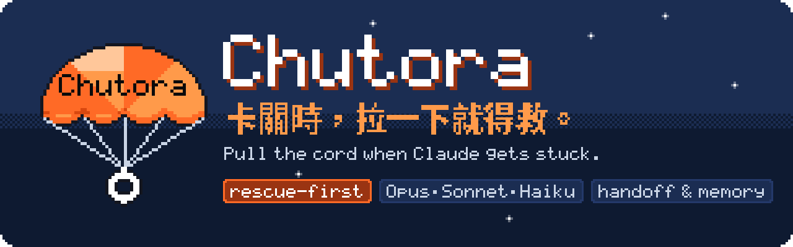
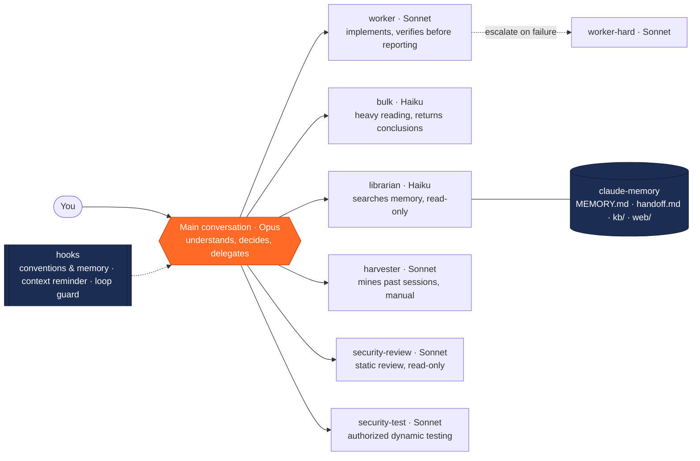

<p align="center">
  
</p>

<p align="center">
  <a href="https://github.com/Novie131/chutora/actions/workflows/ci.yml"></a>
  
  
  
  <a href="LICENSE"></a>
</p>

<p align="center"><a href="README.md"><b>繁體中文</b></a> · <b>English</b></p>

<p align="center">
  <a href="#demo"> Demo</a> ·
  <a href="#features"> Features</a> ·
  <a href="#quick-start"> How to use</a> ·
  <a href="#how-it-works"> How it works</a> ·
  <a href="#roadmap"> Roadmap</a> ·
  <a href="#docs"> Docs</a>
</p>

# Chutora

<sub>Pronounced <b>choo-TOR-a</b> · from <i>chute</i>, as in parachute</sub>

**Fly light. Go further: do the most effective work with the fewest tokens.** Opus is the lead who thinks, Sonnet and Haiku do the hands-on work and send back only conclusions; when the conversation gets long it writes a handoff note first, then picks up from the note after a clear.

> **Agent = Model + Harness.** Chutora doesn't swap the model; it changes what surrounds it: who does the work, what gets into the context, and what gets remembered.

The Traditional Chinese docs are the primary version; this English version is a translation and may lag behind.

<a name="why"></a>

##  What Chutora does

**Goal**: do the most effective work with the fewest tokens. Every token in the main conversation earns its place, and long sessions don't get more expensive and messier as they grow.

| Common pain | Claude Code alone | With Chutora |
|---|---|---|
|  Everything runs on the most expensive model | Reading logs, viewing screenshots and editing dozens of files all cost Opus prices | Opus only thinks and decides; hands-on work goes to Sonnet, heavy reading to Haiku |
|  One install or one log floods the context | Thousands of progress lines stay in the conversation and are re-read every turn | Trimmed before entering the context; unchanged re-reads get one line; huge MCP payloads are trimmed too, with the original saved |
|  Conversations keep growing | Later turns cost more and get messier; clearing loses your progress | Past 100k tokens you're reminded to write a handoff note; after a compact, `/clear` or a new session the next day, it comes back automatically |
|  The AI is stuck on the same error | Endless retries, burning tokens | Loop guard nudges a change of direction; failures escalate in a fixed order with no endless retries |
|  Misunderstood, built, redone | Starts building on its own reading of the task | When the task is vague or you're unsure, it asks a few multiple-choice questions first |
|  "I think we noted this before" | You explain it all again | Memory is plain Markdown; librarian returns verbatim excerpts with sources; works with git and Obsidian |
|  Can I trust this conclusion? | Facts and guesses are mixed together | evidence-analysis labels each conclusion as observation, inference or unknown, with sources |
|  Security | Only reviewed when you remember to | security-review for static review; security-test only against authorized, isolated environments |
|  Getting better with use | You repeat the same instructions every time | harness-tune bakes lessons into the harness and records them in harness-lessons |
|  Where the money goes | Invisible | usage-stats reports and the live agent-board |

**Works right after install**: two commands, no changes to your CLAUDE.md. Advanced setup asks one item at a time and backs up settings first; subagents must verify before reporting done and stop to ask you at forks.

---

<a name="demo"></a>

##  Chutora in 40 seconds

<p align="center"><a href="assets/demo.mp4"></a></p>
<p align="center"><sub>Illustrative animation, not a screen recording · <a href="assets/demo.mp4">▶ Watch the full 41-second video (Chinese and English captions)</a></sub></p>

---

<a name="features"></a>

##  Main features

The first four groups all do one thing: **the main conversation only receives the tokens it actually needs**. In the "Trigger" column, **auto** means it works once installed; **delegated** means you just talk normally and the main conversation decides whether to hand the work to it; **command** means you invoke it (`/chutora:<name>` when installed as a plugin, `/<name>` when installed with install.sh); **optional** means it needs a separate install or setting.

### 1. Tiered delegation: spend the expensive model only where it counts

| Feature | Trigger | What it does |
|---|---|---|
| `worker` (Sonnet) | delegated | Implementation once the direction is settled: writing or changing code, fixing bugs, adding tests. Must verify before reporting done |
| `worker-hard` (Sonnet, effort high) | delegated | Used only after worker fails, with the previous failure report attached |
| `bulk` (Haiku) | delegated | Heavy reading where only the conclusion matters: many images or frames, long logs, fetching web pages, commands with lots of output, rule-based batch edits |
| Haiku `Explore` | optional | Code and file search. The built-in Explore runs on Opus when the main conversation does; this one runs on Haiku |
| Verified reports and failure escalation | auto | Subagents report status and verification in a fixed format; failures escalate in a fixed order with no endless retries; at a fork they stop and ask you |

### 2. Keep it out: trimming and dedup

| Feature | Trigger | What it does |
|---|---|---|
|  Noisy-output trimming | auto | Long, noisy command output such as installs, builds and test runs is trimmed before it reaches the context: color codes stripped, progress bars and repeated lines collapsed, the start, the end, errors and summaries kept. File-reading commands, `git diff` and failed commands are left alone. Turn off with `/chutora trim off` or `CHUTORA_TRIM=0` |
|  Read dedup | auto | When the same conversation re-reads the same unchanged range, it gets one line ("same as read #N") instead of the whole file again. The main conversation and each subagent are counted separately; after a compact, `/clear` or `/rewind` the earlier content is gone, so files are read normally again. Steps aside when Claude Code's own equivalent already fired. Turn off with `/chutora dedup off` or `CHUTORA_DEDUP=0` |
|  MCP output trimming | auto | When MCP tools such as Slack, databases or web fetchers return a huge payload, long lists keep the first few dozen items with a count of the rest, repeated items are merged, overlong strings are cut and empty fields dropped. Supports an exclude list. Turn off with `/chutora mcp-trim off` or `CHUTORA_MCP_TRIM=0` |

Whatever is trimmed or deduped is always saved in full under `~/.claude/chutora/raw/` (the latest 50), and Claude reads it back with Read when needed. Thresholds depend on the mode: economy trims most, quality least.

### 3. Long-conversation management: stays under control as it grows

| Feature | Trigger | What it does |
|---|---|---|
| Context-length reminder | auto | Reminds once past 100k tokens, then every additional 40k (adjust with `CONTEXT_REMIND_TOKENS`) |
| `handoff` | command | Writes the current task, what's done, next steps and open questions to `handoff.md`, so you can safely `/clear`. Saying "hand off" also triggers it |
| Handoff auto-restore | auto | After a new session, `/clear` or auto-compact, brings back the delegation conventions, memory index and `handoff.md` |
| Context status line | optional | Shows `model │ ctx 95k │ reminder 100k │ compact 120k` |
| Auto-compact threshold | optional | Set `autoCompactWindow` in `settings.json` as a safety net; `route-setup` can write it safely for you |

### 4. Clarify first: ask before building

Misunderstanding the task and redoing it is the biggest token waste of all. A lightweight take on the clarify step in [github/spec-kit](https://github.com/github/spec-kit):

| Feature | Trigger | What it does |
|---|---|---|
|  Clarify | auto / command | When you say "ask me first", run `/chutora ask`, or say you're not sure ("not sure", "what do you think"), or when a big task is vague (several files, unclear scope, several approaches), the main conversation first asks 3 to 5 multiple-choice questions (economy 3, balanced 4, quality 5), the recommended option first, with "use the defaults, stop asking" always available. It only asks about scope, what counts as done, constraints, edge cases and trade-offs. Small or already-clear tasks are not questioned; subagents never ask |
| Task brief | auto | The answers go into `claude-memory/briefs/<date>-<slug>.md` (or the auto memory folder) and are attached when delegating to worker; "what counts as done" becomes the acceptance criteria |

`/chutora ask off` or `CHUTORA_ASK=0` turns off the automatic reminder when you say you're unsure; asking on big vague tasks is part of the delegation conventions and always applies.

### 5. Measurement and waste protection

| Feature | Trigger | What it does |
|---|---|---|
| Loop guard | auto | Reminds you to change direction when the same error keeps repeating (reminds, never blocks); also records per-tool usage counts |
| `toolprune` | command | Reads the tool-usage record and lists tools or MCP servers that have gone unused and could be turned off. Suggests only, never changes settings; one step to undo |
| Weekly recap | auto | The first conversation each week shows one estimated line: the model-price difference delegation saved, plus the tokens trimming and dedup kept out of the context; turn off with `CHUTORA_WEEKLY=0` |
| `usage-stats` | command | Measures main-conversation context length, per-agent delegation counts, token usage and estimated cost; `--html` outputs a report with daily charts |

### 6. Memory and knowledge base: accumulates across conversations

| Feature | Trigger | What it does |
|---|---|---|
| `claude-memory/` | optional | Plain Markdown: `MEMORY.md` index, `topics/` knowledge agents accumulate, `kb/` your notes, `web/` external sources, `briefs/` clarify task briefs. Works with git and opens in Obsidian |
| `librarian` (Haiku) | delegated | Searches memory and the knowledge base when you ask "did we note this before?". Read-only; returns verbatim excerpts with sources |
| `research` | delegated / command | Looks up official docs, API usage, version differences and other facts that may have changed; answers cite sources and official material is saved to `web/` |
| `harvester` (Sonnet) | only when you explicitly ask | Mines past conversation transcripts into knowledge-base notes. Costly; run occasionally |
| micro-skills | built-in template | A convention in the `MEMORY.md` template and delegation guide: record a project's fixed commands and facts as short, condition-triggered memories, read only when needed |

### 7. Analysis quality and security

| Feature | Trigger | What it does |
|---|---|---|
| `evidence-analysis` | delegated / command | For investigations, root-causing and reviewing conclusions. Labels every conclusion as observation, inference or unknown with sources, goes from overview to detail, and leaves a traceable finding ledger |
| `security-review` (Sonnet) | delegated | Static review against OWASP categories: unsafe patterns, leaked keys or tokens. Read-only; reports with evidence, severity and fixes. Only for your own or authorized code |
| `security-test` (Sonnet) | delegated | Dynamic testing against your own authorized, isolated dev/test environment to verify vulnerabilities. Always confirms scope first; never touches production or sends data out |

### 8. Self-improvement: gets smoother with use

| Feature | Trigger | What it does |
|---|---|---|
| `harness-tune` | command | For a kind of task that keeps going badly: reads past lessons, proposes one to three small adjustments, and after you confirm changes one thing at a time, with a backup and rollback |
| `harness-lessons.md` | auto (written by harness-tune) | Records each adjustment's result (worked, didn't, rolled back) so the next tune starts from the last conclusion |

### 9. Entry point, interface and setup

| Feature | Trigger | What it does |
|---|---|---|
| `/chutora` | command | Single entry point: status overview (version, mode, context, loop guard, each switch and how much it has saved) plus a menu; reply with a number to run it |
| `/chutora doctor` | command | Read-only install check: python3, hooks, status line, memory store, auto-compact, Haiku Explore, old-version leftovers, with a fix for each problem |
| Three modes | command | `/chutora mode economy` / `balanced` / `quality`: changes the delegation conventions injected at session start, the trimming thresholds and how many clarify questions are asked; does not change any agent's model |
| Chinese and English | auto | Reminders, the status line and `/chutora` follow the system language; pin it with `/chutora lang zh` / `en` / `auto` |
| `agent-board` | optional | A persistent board above the input box listing each subagent's type, model, status, elapsed time, tokens and estimated cost. Toggle with `/agent-board` |
| `reply-detail` | optional | Replies default to three short parts (status / what you need to do / what needs your decision or input); switch with the board's reply-mode switch ("⇄ 回覆：精簡／詳細"), or type 「詳細說明」 for a one-off detailed rewrite |
| `route-setup` | command | One-time full setup: memory folder, Haiku Explore, auto-compact threshold, status line. Asks one item at a time and backs up settings before changing them |

---

<a name="quick-start"></a>

##  Three-minute start

**1. Install**: inside Claude Code, run

```
/plugin install chutora --marketplace Novie131/chutora
/reload-plugins
/model opus
```

(Claude Code 2.1.275 and earlier: first `/plugin marketplace add Novie131/chutora`, then `/plugin install chutora@chutora`. To install without the marketplace, see [Other ways to install](docs/advanced.en.md#install). Opus is recommended for the main conversation; the plugin never changes it for you.)

**2. Type `/chutora`**

It's the only command you need to remember. It shows the current status — version, mode, context usage, whether you're stuck on a repeating error — and lists what you can do; just reply with a number. Handoff, usage report, install check, mode and language switching, and full setup are all in there.

If nothing seems to happen after installing, run `/chutora doctor` first; it checks each piece and tells you how to fix it.

**3. Talk normally**

The main conversation decides whether to delegate: "do what we just discussed" goes to worker, "why did this log fail" goes to bulk, "did I note X before" goes to librarian. When the task is unclear it asks you a few multiple-choice questions first; you can also say "ask me first" or type `/chutora ask`. Past 100k tokens you're reminded to write a handoff note, and after a `/clear` or a new conversation the next day your progress comes back automatically.

**4. When you get stuck**

- When the same error keeps repeating, loop guard nudges Claude to change direction; you can also just say "try a different approach" or "stop and summarize what we've tried".
- To go back to an earlier state: Claude Code's built-in `/rewind` (or Esc twice) restores files the main conversation edited directly; files changed by subagents or Bash commands are outside its reach, so use git for those.
- To start over with a clean conversation: say "hand off" to write `handoff.md`, then `/clear`.

**For the full feature set**: run `/chutora:route-setup`. It walks you through the status line, the auto-compact threshold, the Haiku-based Explore and a `claude-memory/` store one item at a time, explains the impact and how to undo each, and backs up settings before changing them. The reminder features need `python3`; without it they quietly turn themselves off.

---

<a name="how-it-works"></a>

##  How it works



| Component | Model | What it does |
|---|---|---|
| worker | Sonnet, effort medium | Work whose direction is already decided: writing code, fixing bugs, adding tests. It must verify before reporting done |
| worker-hard | Sonnet, effort high | Only used after worker fails; the delegation must include the previous failure report |
| bulk | Haiku | Reads large amounts of material and returns only conclusions: many images, long logs, web pages, commands with huge output, and mechanical batch edits |
| librarian | Haiku, effort low | Searches the knowledge base and memory. It has only `Read`, `Glob`, and `Grep`, so it cannot modify anything; it returns verbatim excerpts with their sources, plus which terms it searched and what it did not find |
| harvester | Sonnet | Mines past conversation transcripts into knowledge-base notes. Only runs when you explicitly ask; it is costly |
| security-review | Sonnet, effort medium | Static security review of your own code (OWASP categories, evidence and remediation, severity). Read-only; only for code you own or are authorized to test |
| security-test | Sonnet, effort medium | Dynamic security testing against your own, authorized, isolated dev environment to confirm whether findings are exploitable. Confirms the authorization scope first, never touches production, never exfiltrates data |
| Explore (optional) | Haiku | The built-in Explore runs on Opus when the main conversation is Opus. A plugin cannot override it (only a user- or project-level agent named `Explore` can), so route-setup or `bash install.sh --with-explore` installs a Haiku version into `~/.claude/agents/` |

- **Skills**: `handoff` writes `handoff.md`; `research` looks up external information and cites sources; `usage-stats` measures main-conversation context length and, per agent, dispatch counts, token usage, and estimated cost (read-only; add `--html` for a report with charts); `route-setup` is the one-time full setup.
- **Hooks**: SessionStart injects the delegation guide, the memory index, and the handoff note; UserPromptSubmit reminds you when the context window is too long.
- **Analysis & security**: `evidence-analysis` (separates observation / inference / unknown and cites sources); `security-review` / `security-test` (defensive security: static review plus authorized dynamic testing). The security capabilities apply only to your own or explicitly authorized code and environments; dynamic testing runs only in an isolated environment, never touches production, and never exfiltrates data.
- **Saving tokens & self-improvement**: `toolprune` (flags long-unused tools and suggests disabling them, reversibly); `harness-tune` (adjusts the harness for a recurring task type, confirmed before changing and roll-back-able, from harness2); a PostToolUse `loop guard` hook (nudges you to change course when the same error repeats, nudge-only, never interrupts, from TokenEconomizer); micro-skills (records this repo's fixed command facts into memory).

How the main conversation delegates does not depend on your CLAUDE.md: the SessionStart hook injects the delegation table at the start of every session (see `hooks/guide.md`). Design rationale and trade-offs are in [docs/spec.md](docs/spec.md) (Traditional Chinese).

---

<a name="benchmark"></a>

##  Benchmark

"The fewest tokens" should be backed by numbers, so the repo ships a repeatable measurement tool, `bench/run.py`.

**What it measures**: three small fixed tasks (fix a bug, find and fix why a build fails from a long, noisy log, find a function among many files), each run N times without Chutora and with Chutora. Every run records total tokens (cache reads and writes included), the cost `claude -p` reports, the number of turns, and whether the task's acceptance command passes; the summary uses medians.

**How to run it**:

```
python3 bench/run.py --dry-run                              # preview what would run, no model calls
ANTHROPIC_API_KEY=... python3 bench/run.py --runs 3 --model opus
```

- Every run uses a fresh temp folder, a temp HOME and a temp `CLAUDE_CONFIG_DIR`, so your `~/.claude` is never read; the "with Chutora" arm loads the repo's `plugins/chutora` with `--plugin-dir`.
- It needs an API key and **costs money**. Each run is capped at $1 by default (`--max-budget-usd`).
- Results go to `bench/results/` (a Markdown table and JSON), which is not under version control.

**No numbers have been published yet.** Nothing goes here until a real run has been done and checked. Limits up front: the tasks are small and the sample is small, so results only show direction; cost is the client-side estimate from `claude -p`, not your bill.

---

<a name="roadmap"></a>

##  Roadmap

| Status | Item | What it does |
|---|---|---|
|  Done (0.12) | Easier to use | `/chutora` entry point, `/chutora doctor` install check, Chinese/English messages, three modes, weekly recap, docs split into a three-minute start and an advanced guide |
|  Done (0.13) | Noisy-output trimming | Long, noisy command output is trimmed before it reaches the main conversation, keeping errors, summaries and key lines; can be turned off, and the original stays readable |
|  Done (0.13) | Token benchmark tool | `bench/run.py` measures tokens, cost and completion rate on fixed tasks with and without Chutora; **no numbers published yet**, see [Benchmark](#benchmark) |
|  Done (0.14) | Read dedup, MCP output trimming, clarify | Unchanged re-reads in the same conversation get one line; huge MCP payloads are trimmed first; vague tasks or "not sure" get a few multiple-choice questions first, with the answers saved as a task brief |
|  Next | Flight deck | The status line shows what Claude is doing right now; agent-board grows into a full panel: action timeline, plain-language labels, files touched, to-do progress and per-model workload |
|  Planned | Code map and blast radius | A compact symbol index saved to memory; before changing a function, list what it affects; warns when the index is stale |
|  Planned | Dangerous-action guard | Always confirm before deleting files, force-pushing or touching production |
|  Planned | Routing that learns from outcomes | Record how each delegation turned out and suggest delegation-table fixes, applied only after you confirm |
|  Planned | Stuck rescue | When the AI keeps failing and every fix makes it worse: gather evidence, stop the bleeding, offer two or three ways out, and record the lesson |
|  Planned | Project checkup | Beyond the `/chutora doctor` install check: test gaps, stale memory, unused tools and a quick security sweep in one go |

Every new feature follows the same principle: **lightweight, manual, reversible** — no extra token burn for the sake of automation.

**Open-source methodologies absorbed**: rea (evidence-based analysis), strix (security review and testing), TokenEconomizer (token savings), [harness2](https://github.com/google-research/harness2) (self-improvement); planned items draw on [ruflo](https://github.com/ruvnet/ruflo) and [codegraph](https://github.com/colbymchenry/codegraph). Chutora takes only the methods and implements them itself; it contains none of their code.

---

<a name="docs"></a>

##  More docs

| Doc | What's in it |
|---|---|
| [Advanced guide](docs/advanced.en.md) | What problem this solves, usage and glossary, modes / language / weekly recap, how it works in detail, advanced settings, memory, design trade-offs, other ways to install, layout |
| [FAQ](docs/faq.en.md) | Does it cost anything, does it change my settings, how is it different from `/rewind`, does economy mode hurt quality |
| [Troubleshooting](docs/troubleshooting.en.md) | Nothing happens after install, messages are in the wrong language, no status line, agents show up twice |
| [Deployment notes](docs/%E9%83%A8%E7%BD%B2%E5%AE%89%E8%A3%9D.md) (Chinese) | install.sh, uninstalling, upgrading from old versions |
| [Architecture](docs/spec.md) (Chinese) | Design rationale and implementation notes |

---

<a name="status"></a>

##  Status

**v0.14.0, early version.** Versions up to 0.10.0 were named smart-agent-route, and up to 0.7.0 tiered-agents; to upgrade, remove the old version first (see the section on upgrading from tiered-agents (0.7.0 and earlier) in the [deployment notes](docs/%E9%83%A8%E7%BD%B2%E5%AE%89%E8%A3%9D.md)). The context reminder hook, handoff, bulk, and the Explore override were ported from the author's personal setup: the hook has fired in real conversations and Explore and bulk are confirmed to run on Haiku, but all are still being validated. The worker-hard escalation chain, the research skill, and the plugin form of the hooks have not been used in practice yet. agent-board and reply-detail have been tested in the VS Code extension 2.1.301 for the board; persistent mode, the button in the board, and the reply-format injection are still being validated. The `/chutora` entry point, doctor, modes, bilingual messages and weekly recap added in 0.12 have unit tests but haven't been validated in long real-world use yet. Noisy-output trimming (0.13) and read dedup, MCP output trimming and clarify (0.14) have unit tests, but the format for replacing tool output was inferred from Claude Code's type definitions and docs and has not yet been confirmed in a real session.

Known rough edges:

- Delegation relies on `description` matching and is not guaranteed. To be sure, use `@agent-chutora:worker`.
- Hook behavior in Cowork is unverified.
- `MEMORY.md` decays and needs periodic tidying (over 150 lines is the signal).
- The Haiku execution layer is empty by default; see the enabling conditions in `plugins/chutora/skills/route-setup/templates/runner.md.example`.
- `harvester` only reads local sessions.
- The mod API is marked early access; Claude Code updates may require adjustments.

Issues are welcome.

---

<a name="license"></a>

##  License

MIT
