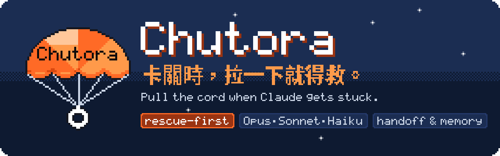

<p align="center">
  
</p>

<p align="center">
  <a href="https://github.com/Novie131/chutora/actions/workflows/ci.yml"></a>
  
  
  
  <a href="LICENSE"></a>
</p>

<p align="center"><b>繁體中文</b> · <a href="README.en.md"><b>English</b></a></p>

<p align="center">
  <a href="#demo"> Demo</a> ·
  <a href="#features"> 主要功能</a> ·
  <a href="#quick-start"> 如何使用</a> ·
  <a href="#how-it-works"> 運作方式</a> ·
  <a href="#roadmap"> 路線圖</a> ·
  <a href="#docs"> 更多文件</a>
</p>

# Chutora

<sub>唸作 <b>choo-TOR-a</b>（啾托拉）· 取自 chute（降落傘）</sub>

**輕一點，飛更遠：用最少的 token 做最有效率的事。** Opus 當主管負責想，Sonnet 和 Haiku 負責動手，只把結論交回主對話；對話變長時先寫交接筆記，清空後照筆記接著做。

> **Agent = 模型 + Harness。** Chutora 不換模型，改的是模型外圍那一圈：誰來做、什麼能進到 context、記得什麼。

> A Claude Code plugin for tiered model delegation — Opus plans, Sonnet executes, Haiku retrieves and digests bulk output — plus handoff notes, source-cited memory, loop guards and a self-tuning harness. English documentation: [README.en.md](README.en.md).

<a name="why"></a>

##  Chutora 在做什麼

**目的**：用最少的 token 做最有效率的事。主對話的每個 token 都花在刀口上，長時間工作也不會越拉越貴、越來越亂。

| 常見困境 | 單用 Claude Code | 加上 Chutora |
|---|---|---|
|  所有事都用最貴的模型 | 讀 log、看截圖、改幾十個檔都付 Opus 的價 | Opus 只負責想和判斷，動手交給 Sonnet，大量讀取交給 Haiku |
|  一次安裝、一份 log 就塞爆 context | 幾千行進度訊息整份留在對話裡，之後每一輪都重讀 | 進到 context 前先瘦身；重讀沒變的檔案只回一行；MCP 的大坨資料也先瘦身，原文另存 |
|  對話越拉越長 | 越後面越貴、越亂；一清空進度就沒了 | 超過 10 萬 token 先提醒寫交接筆記；壓縮、`/clear` 或隔天開新對話都自動接回 |
|  AI 卡在同一個錯誤 | 反覆重試、一直燒 token | loop guard 提醒換方向；失敗依固定順序升級，不會無限重試 |
|  會錯意、做錯再重做 | 一開工就照自己的理解做下去 | 需求模糊或你說不確定時，先用選擇題問清楚再動手 |
|  「之前好像講過」 | 每次都要重新解釋 | 記憶就是 Markdown，librarian 查回原文與出處，可以進 git、用 Obsidian 開 |
|  結論可不可信 | 事實和推測混在一起 | evidence-analysis 把結論分成觀察、推論、未知，附出處 |
|  安全 | 要自己想到才會審 | security-review 靜態審查，security-test 只在授權的隔離環境動態測試 |
|  越用越順手 | 同樣的話每次都要多講一遍 | harness-tune 把教訓固化進 harness，記在 harness-lessons |
|  錢花在哪 | 看不到 | usage-stats 量測報表，agent-board 即時看板 |

**裝完就能用**：兩行指令，不用改你的 CLAUDE.md。進階設定一次只問一項，改設定前先備份；子 agent 回報完成前必須驗證，遇到岔路會停下來問你。

---

<a name="demo"></a>

##  40 秒看懂 Chutora

<p align="center"><a href="assets/demo.mp4"></a></p>
<p align="center"><sub>示意動畫，不是實機錄影 · <a href="assets/demo.mp4">▶ 觀看完整 41 秒影片（中英字幕）</a></sub></p>

---

<a name="features"></a>

##  主要功能

前四類都在做同一件事：**讓主對話只收到真正需要的 token**。「觸發」欄的 **自動** 表示裝好就會運作；**派工** 表示照平常講話，主對話會自己判斷要不要交給它；**指令** 表示你要叫它（plugin 安裝時寫成 `/chutora:<名稱>`，install.sh 安裝時直接 `/<名稱>`）；**選裝** 表示要另外安裝或設定。

### 1. 分層派工：貴的模型只用在刀口上

| 功能 | 觸發 | 做什麼 |
|---|---|---|
| `worker`（Sonnet） | 派工 | 方向已定的實作：寫或改程式、修 bug、補測試。回報完成前必須先驗證 |
| `worker-hard`（Sonnet，effort high） | 派工 | 只在 worker 失敗後使用，必須附上前次失敗報告 |
| `bulk`（Haiku） | 派工 | 大量讀取只回結論：多張圖片或影格、長 log、抓網頁、輸出很多的指令、規則明確的批次修改 |
| Haiku 版 `Explore` | 選裝 | 搜尋程式碼、找檔案。內建 Explore 會跟著主對話跑 Opus，換成這個改跑 Haiku |
| 驗證回報與失敗升級 | 自動 | 子 agent 用固定格式回報狀態與驗證結果；失敗依序升級，不會無限重試；遇到岔路會停下來問你 |

### 2. 擋在門外：瘦身與去重

| 功能 | 觸發 | 做什麼 |
|---|---|---|
|  噪音輸出瘦身 | 自動 | 安裝、建置、測試這類又長又雜的指令輸出，進到 context 前先瘦身：去色碼、收斂進度列與重複行，保留開頭、結尾、錯誤與摘要。讀檔類指令、`git diff`、失敗的指令都不動。`/chutora trim off` 或 `CHUTORA_TRIM=0` 關閉 |
|  讀檔去重 | 自動 | 同一段對話裡再讀一次「沒變的同一個範圍」時，只回一行「跟第 N 次讀的一樣」，不再整份重送。主對話與每個子 agent 分開算；壓縮、`/clear`、`/rewind` 後舊內容不在對話裡，就照常重讀。Claude Code 內建的同類機制有出手時不重複處理。`/chutora dedup off` 或 `CHUTORA_DEDUP=0` 關閉 |
|  MCP 輸出瘦身 | 自動 | Slack、資料庫這類 MCP 工具回傳一大坨 JSON 時，長陣列只留前幾十筆並註明另有幾筆、連續相同的項目合併、空欄位拿掉。純文字和 Markdown（例如使用說明、文件內容）不動。`/chutora mcp-trim exclude <server>` 讓某個 server 完全不瘦身；`/chutora mcp-trim off` 或 `CHUTORA_MCP_TRIM=0` 關閉 |

被瘦身或去重的原文一定另存在 `~/.claude/chutora/raw/`（保留最近 50 份），Claude 需要時會用 Read 讀回來。三種模式的門檻不同：省錢最積極、品質最保守。

### 3. 長對話管理：對話變長也不失控

| 功能 | 觸發 | 做什麼 |
|---|---|---|
| context 長度提醒 | 自動 | 超過 10 萬 token 提醒一次，之後每多 4 萬再提醒（可用 `CONTEXT_REMIND_TOKENS` 調整） |
| `handoff` | 指令 | 把目前任務、已完成、下一步、未決問題寫進 `handoff.md`，之後可以放心 `/clear`。說「交接一下」也會觸發 |
| 交接筆記自動帶回 | 自動 | 新對話、`/clear`、自動壓縮之後，自動帶入分工慣例、記憶索引與 `handoff.md` |
| context 狀態列 | 選裝 | 顯示 `模型 │ ctx 95k │ 提醒 100k │ 壓縮 120k` |
| 自動壓縮門檻 | 選裝 | 在 `settings.json` 設 `autoCompactWindow` 當保險，`route-setup` 可以幫你安全寫入 |

### 4. 反問：先問清楚再動手

會錯意、做錯再重做，是最大的 token 浪費。參考 [github/spec-kit](https://github.com/github/spec-kit) 的 clarify 步驟，做成輕量版：

| 功能 | 觸發 | 做什麼 |
|---|---|---|
|  反問 | 自動／指令 | 你說「先問我」、`/chutora ask`、或說「我不太清楚」「不確定」「你覺得呢」時，或大任務需求模糊時（會動多個檔案、範圍不明、有多種做法），主對話先用選擇題問你 3 到 5 題（省錢 3、平衡 4、品質 5），每題第一個是建議選項，也可以「照預設、別問了」。只問範圍、怎樣算完成、限制、邊界情況、取捨。小事和已經講清楚的不問；子 agent 不會問 |
| 任務說明 | 自動 | 答案寫成 `claude-memory/briefs/<日期>-<slug>.md`（沒有 claude-memory 時放 auto memory 目錄），派工時附給 worker；「怎樣算完成」就是驗收標準 |

`/chutora ask off` 或 `CHUTORA_ASK=0` 關閉「你說不確定時」的自動提醒；大任務自動反問寫在分工慣例裡，一直有效。

### 5. 量測與白燒保護

| 功能 | 觸發 | 做什麼 |
|---|---|---|
| loop guard | 自動 | 同一個錯誤一再重複時提醒換方向，只提醒不中斷；同時記錄各工具的使用次數 |
| `toolprune` | 指令 | 讀工具使用記錄，列出長期沒用到、可以關掉的工具或 MCP。只建議不自動改，一步就能復原 |
| 每週回顧 | 自動 | 每週第一個對話附一行估算：派工省下的模型價差，以及瘦身與去重擋在 context 外的 token；`CHUTORA_WEEKLY=0` 關閉 |
| `usage-stats` | 指令 | 量主對話 context 長度、各 agent 的派工次數、token 用量與估計金額；加 `--html` 輸出有每日圖表的報表 |

### 6. 記憶與知識庫：跨對話累積

| 功能 | 觸發 | 做什麼 |
|---|---|---|
| `claude-memory/` 記憶庫 | 選裝 | 一般 Markdown 檔：`MEMORY.md` 索引、`topics/` agent 累積的知識、`kb/` 你的筆記、`web/` 外部資料、`briefs/` 反問的任務說明。可以進 git、用 Obsidian 開 |
| `librarian`（Haiku） | 派工 | 問「之前記過什麼」時查記憶與知識庫。只讀不寫，回傳原文片段與出處 |
| `research` | 派工／指令 | 查官方文件、API 用法、版本差異等可能已變動的資訊，回答附來源，官方資料存進 `web/` |
| `harvester`（Sonnet） | 只在你明確要求時 | 把過去的對話紀錄挖成知識庫筆記。成本較高，偶爾跑一次 |
| micro-skills | 內建範本 | `MEMORY.md` 範本與分工慣例裡的寫法：把專案的固定指令與事實寫成短小的條件式記憶，用到才讀，少走回頭路 |
| 變更紀錄（實驗中） | 自動 | `claude-memory/changes.jsonl` 記下做了什麼、復原點在哪、有沒有告訴你、你怎麼回應；目前由危險守門寫入，給之後會改設定的功能用 |
| 記憶身分資料（實驗中） | 新寫入時 | 新的記憶檔開頭帶 id、建立與最後使用時間、可信度、來源、依據的檔案與指紋、版本、取代關係與狀態；既有記憶檔不改寫。格式見[進階說明](docs/advanced.md#memory) |

### 7. 分析品質與資安

| 功能 | 觸發 | 做什麼 |
|---|---|---|
| `evidence-analysis` | 派工／指令 | 調查、找根因、審查結論時使用。每個結論標成觀察、推論或未知並附出處，先給概覽再深入，最後留一份可追查的 finding ledger |
| `security-review`（Sonnet） | 派工 | 靜態審查：對照 OWASP 類別，找不安全寫法、金鑰或 token 外洩。只讀不改，回報附證據、嚴重度與修補建議。只用於你自己或已授權的程式碼 |
| `security-test`（Sonnet） | 派工 | 動態測試：實際打你已授權且隔離的 dev／測試環境，驗證漏洞。開工前一定先確認授權範圍，不碰 production、不外送資料 |
| 危險守門（實驗中） | 自動 | 工具執行前檢查「永遠要問清單」：force push、推到 main、刪專案外的檔案、碰 `.env` 或金鑰檔、`DROP TABLE`、`terraform destroy`、`kubectl delete`、改 Claude Code 或 Chutora 設定、`git reset --hard`、`git clean -f` 先問你；`rm -rf ~`、`rm -rf /` 這類直接擋。略過權限模式（`--dangerously-skip-permissions`）下確認視窗可能被跳過，所以備份不了的 force push、刪專案外／家目錄的東西、`DROP TABLE`、`terraform destroy`、`kubectl delete` 改成直接擋。`/chutora:route-setup` 已經逐項問過你，跑它自己的設定腳本時不再問第二次。`git push origin feat/x`、`rm -rf node_modules` 不攔。清單可在 `~/.claude/chutora/always-ask` 增減；`/chutora guard off` 或 `CHUTORA_GUARD=0` 關閉 |

### 8. 自我強化：越用越順手

| 功能 | 觸發 | 做什麼 |
|---|---|---|
| `harness-tune` | 指令 | 某類任務一再做不順時使用：先讀過去的教訓，提出一到三個小調整，你確認後一次只改一項，改前備份、可回滾 |
| `harness-lessons.md` | 自動（由 harness-tune 寫入） | 記錄每次調整的結果（有效、無效、已還原），下一次調整從上一次的結論出發 |
| 觀察紀錄（實驗中） | 自動 | 學習的地基：把工具成功／失敗、重複錯誤、子 agent 結果、你的糾正（「不對」「我不是要這個」）與選擇，以及哪些輸出常被瘦身、哪些檔案一再重讀，記到 `~/.claude/chutora/projects/<專案 id>/observations.jsonl`。不輸出任何東西所以不花 token；只存精簡摘要、不存工具輸出、遮罩金鑰；超過 5 MB 自動輪替。`/chutora observe privacy strict` 讓你的糾正與選擇只記長度。`/chutora observe off` 或 `CHUTORA_OBSERVE=0` 關閉 |

### 9. 入口、介面與設定

| 功能 | 觸發 | 做什麼 |
|---|---|---|
| `/chutora` | 指令 | 單一入口：狀態總覽（版本、模式、context、loop guard、各開關與累計省下的量）加上功能選單，回覆編號就能執行 |
| `/chutora doctor` | 指令 | 唯讀安裝健檢：python3、hooks、狀態列、記憶庫、自動壓縮、Haiku Explore、舊版殘留、危險守門自訂規則、觀察紀錄，要修的項目附修法 |
| 三種模式 | 指令 | `/chutora mode economy`／`balanced`／`quality`：改變 session 開始時帶入的派工慣例、瘦身門檻與反問題數，不改各 agent 的模型 |
| 中英雙語 | 自動 | 提醒訊息、狀態列、`/chutora` 依系統語言切換；`/chutora lang zh`／`en`／`auto` 可固定 |
| 駕駛艙狀態列 | 自動（設好狀態列後） | Claude 工作時狀態列即時顯示目前動作：`▶ worker·Sonnet 跑測試 npm test · 12s │ 本次 42k tok │ 瘦身省≈8k │ ctx 95k/120k`；閒置時維持原本的精簡版。只用官方狀態列與標準 hooks，`CHUTORA_ACTIVITY=0` 關閉 |
| 駕駛艙面板（`agent-board`） | 選裝 | 輸入框上方或側邊的常駐面板：「現在」大卡、待辦分格進度、三色工作量長條（交出去的比例、瘦身擋下的量、主對話 context）、動作時間線（白話＋原始指令、子 agent 縮排在派工下）、碰過的檔案（附增刪行數）、子 agent 列表。桌面版／VS Code／手機用圖像版，終端機用文字版。用 `/agent-board` 開關 |
| `reply-detail` | 選裝 | 回覆預設精簡三段（現況／你要做的／需要你決定或提供）；用看板的「⇄ 回覆：精簡／詳細」切換，或輸入「詳細說明」單次改寫成詳細版 |
| `route-setup` | 指令 | 一次性完整設定：記憶庫、Haiku 版 Explore、自動壓縮門檻、狀態列。一次只問一項，改設定前先備份 |

---

<a name="quick-start"></a>

##  三分鐘上手

**1. 安裝**：在 Claude Code 裡輸入

```
/plugin install chutora --marketplace Novie131/chutora
/reload-plugins
/model opus
```

（Claude Code 2.1.275 以前：先 `/plugin marketplace add Novie131/chutora`，再 `/plugin install chutora@chutora`。不想用 marketplace，見[其他安裝方式](docs/advanced.md#install)。主對話建議用 Opus，plugin 不會自動幫你改。）

**2. 輸入 `/chutora`**

這是唯一要記的指令。它會顯示目前狀態：版本、模式、context 用量、有沒有卡在同一個錯誤，再列出能做的事，回覆編號就好。交接、用量報表、健檢、切換模式和語言、完整設定都在裡面。

裝完覺得沒反應，先跑 `/chutora doctor`，它會逐項檢查並告訴你怎麼修。

**3. 照平常講話**

主對話會自己判斷要不要派工：說「照剛才講的做」就交給 worker，「看這份 log 為什麼失敗」就交給 bulk，「我之前記過 X 嗎」就交給 librarian。需求不清楚時，它會先用選擇題問你幾題；你也可以直接說「先問我」或輸入 `/chutora ask`。對話超過 10 萬 token 會提醒你先寫交接筆記，之後不管是 `/clear` 還是隔天開新對話，進度都會自動接回。

**4. 卡住怎麼辦**

- 同一個錯誤一直重複時，loop guard 會提醒 Claude 換方向；你也可以直接說「換個做法」或「先停下來整理目前試過什麼」。
- 想退回之前的狀態：Claude Code 內建的 `/rewind`（或按兩下 Esc）能還原主對話直接改的檔案；子 agent 和 Bash 指令改的檔案不在它的範圍內，這部分請用 git 還原。
- 想換個乾淨的對話重來：說「交接一下」寫好 `handoff.md`，再 `/clear`。

**想要完整功能**：執行 `/chutora:route-setup`，它會一項一項帶你設定狀態列、自動壓縮門檻、Haiku 版 Explore、`claude-memory/` 記憶庫，每項都說明影響和怎麼還原，改設定前會備份。提醒類功能需要 `python3`，沒有的話會安靜停用。

---

<a name="how-it-works"></a>

##  運作方式


| 元件 | 模型 | 做什麼 |
|---|---|---|
| worker | Sonnet，effort medium | 方向已定的實作：寫程式、修 bug、補測試。回報完成前必須先驗證 |
| worker-hard | Sonnet，effort high | 只在 worker 失敗後使用，派工時必須附上前次失敗報告 |
| bulk | Haiku | 大量讀取、只回結論：大量圖片、長 log、網頁、輸出很多的指令，以及機械式的批次修改 |
| librarian | Haiku，effort low | 查知識庫與記憶。只有 `Read`、`Glob`、`Grep`，什麼都改不了；回傳原文片段與來源，並說明搜過哪些詞、什麼沒找到 |
| harvester | Sonnet | 把歷史對話逐字稿挖進知識庫筆記。只在你明確要求時才跑，成本不低 |
| security-review | Sonnet，effort medium | 對你自己的程式碼做靜態安全審查（OWASP 類別、附證據與修補、嚴重度分級）。只讀不改，只用於你擁有或授權的碼 |
| security-test | Sonnet，effort medium | 對你自己、已授權且隔離的 dev 環境做動態安全測試，驗證漏洞是否可利用。開工先確認授權範圍，不碰 production、不外送資料 |
| Explore（選裝） | Haiku | 內建 Explore 在主對話是 Opus 時也跑 Opus。plugin 蓋不掉它（只有使用者或專案層級、名為 `Explore` 的 agent 能覆蓋），所以用 route-setup 或 `bash install.sh --with-explore` 把 Haiku 版裝進 `~/.claude/agents/` |

- **Skills**：`handoff` 寫 `handoff.md`；`research` 查外部資料並附來源；`usage-stats` 量測主對話 context 長度、各 agent 的派工次數、token 用量與估計金額（唯讀；加 `--html` 可輸出圖表報表）；`route-setup` 是一次性完整設定。
- **Hooks**：SessionStart 帶入分工慣例、記憶索引與交接筆記；UserPromptSubmit 在 context 過長時提醒。
- **新增能力**：`evidence-analysis`（證據導向分析：結論分 觀察／推論／未知 並附出處）；`security-review`／`security-test`（防禦性安全：靜態審查＋授權動態測試）。安全能力只用於你自己或明確授權的程式碼與環境，動態測試只在隔離環境、不碰 production、不外送資料。
- **省 token 與自我強化**：`toolprune`（指認長期沒用到的工具、建議停用，可逆）；`harness-tune`（針對某類任務調整 harness，改前確認、可回滾，取自 harness2）；PostToolUse `loop guard` hook（同一錯誤重複就提醒換方向，只提醒不中斷，取自 TokenEconomizer）；micro-skills（把這個 repo 的固定指令事實記進記憶，少走回頭路）。

主對話怎麼分工，不靠你的 CLAUDE.md：SessionStart hook 會在每個 session 開始時把分工表帶進去（內容見 `hooks/guide.md`）。設計理由與取捨見 [docs/spec.md](docs/spec.md)。

---

<a name="benchmark"></a>

##  Benchmark

「用最少的 token」要用數字說話，所以 repo 內附一套可以重複跑的量測工具 `bench/run.py`。

**量什麼**：3 個固定的小任務（修 bug、從又長又雜的建置 log 找出失敗原因並修好、在一堆檔案裡找出某個函式），「沒有 Chutora」和「有 Chutora」各跑 N 次。每次記錄總 token（含快取讀寫）、`claude -p` 回報的花費、輪數，以及有沒有通過任務的驗收指令，最後取中位數。

**怎麼跑**：

```
python3 bench/run.py --dry-run                              # 先看會跑哪些，不呼叫模型
ANTHROPIC_API_KEY=... python3 bench/run.py --runs 3 --model opus
```

- 每次都在全新的暫存資料夾、暫存 HOME 與 `CLAUDE_CONFIG_DIR` 裡跑，不讀你的 `~/.claude`；「有 Chutora」用 `--plugin-dir` 載入 repo 裡的 `plugins/chutora`。
- 需要 API key，**會產生費用**。每次執行預設上限 $1（`--max-budget-usd` 可調）。
- 結果寫到 `bench/results/`（Markdown 表與 JSON），這個資料夾不進版控。

**目前尚未公布數字。** 實際跑完、核對過之前，這裡不放任何數字。限制也先講清楚：任務小、樣本少，只能看方向；花費是 `claude -p` 在用戶端的估算，不等於帳單。

---

<a name="roadmap"></a>

##  路線圖

| 狀態 | 項目 | 說明 |
|---|---|---|
|  已完成（0.12） | 好用優化 | `/chutora` 單一入口、`/chutora doctor` 安裝健檢、中英雙語提醒、三種模式、每週回顧、文件分成三分鐘上手與進階說明 |
|  已完成（0.13） | 噪音輸出瘦身 | 又長又雜的指令輸出進到主對話前先瘦身，只留錯誤、摘要與關鍵行；可以關閉，原文另存可讀 |
|  已完成（0.13） | token benchmark 工具 | `bench/run.py` 用固定任務實測有／沒有 Chutora 的 token、花費與完成率；**數字尚未公布**，見 [Benchmark](#benchmark) |
|  已完成（0.14） | 讀檔去重、MCP 輸出瘦身、反問 | 同一段對話重讀沒變的檔案只回一行；MCP 的大坨資料先瘦身；需求模糊或你說不確定時先用選擇題問清楚，答案寫成任務說明 |
|  已完成（0.15） | 駕駛艙 | 狀態列即時顯示 Claude 正在做什麼（穩定版，只用官方機制）；agent-board 升級成完整面板：現在、待辦進度、工作量、時間線、檔案 |
|  規劃中 | 程式碼地圖與影響範圍 | 產生精簡的符號索引存進記憶，改函式前先列出會受影響的地方；檔案改了會提醒索引過期 |
|  實驗中：feat/v2-batch1 | 危險操作守門 | force push、推到 main、刪專案外的檔案、碰 `.env`、`DROP TABLE` 這類操作先問你，`rm -rf ~` 這類直接擋；略過權限模式下備份不了的改成直接擋；清單可自訂 |
|  實驗中：feat/v2-batch1 | 學習的地基 | 不花 token 的觀察紀錄（含被瘦身、重讀訊號與嚴格隱私開關）、變更紀錄、記憶身分資料；MCP 瘦身不再砍純文字說明 |
|  規劃中 | 路由從結果學習 | 記下每次派工的結果，整理成委派表的修正建議，你確認才改 |
|  規劃中 | 卡關救援 | AI 反覆失敗、越修越亂時一鍵救援：收集證據、停損、給你兩三條脫困路線、把教訓記下來 |
|  規劃中 | 專案健檢 | 在 `/chutora doctor` 的安裝健檢之外，再一次檢查測試缺口、過期記憶、沒用到的工具、安全快掃 |

所有新功能都照同一個原則：**輕量、手動、可逆**，不為了自動化多燒 token。

**吸收過的開源方法論**（只取方法論、自己實作，不含它們的程式碼）：

- [rea](https://github.com/morluto/rea)：證據導向分析（evidence-analysis 的觀察／推論／未知與 finding ledger）
- [strix](https://github.com/usestrix/strix)：安全審查與授權測試（security-review、security-test）
- [TokenEconomizer](https://github.com/microsoft/TokenEconomizer)：省 token 的做法（toolprune、micro-skills、只透過 context 作用的 hook）
- [google-research/harness2](https://github.com/google-research/harness2)：自我強化（harness-tune 與 harness-lessons）
- [github/spec-kit](https://github.com/github/spec-kit)：clarify 步驟（反問）
- [colbymchenry/codegraph](https://github.com/colbymchenry/codegraph)：單一入口與 benchmark 的做法（`/chutora`、`bench/`），也是規劃中「程式碼地圖」的參考
- [rtk](https://github.com/rtk-ai/rtk)：指令輸出瘦身的做法（噪音輸出瘦身）
- [affaan-m/ECC](https://github.com/affaan-m/everything-claude-code)：continuous-learning-v2 的信心分數直覺與觀察 hook（觀察紀錄）
- Cloudflare [Clef](https://blog.cloudflare.com/clef-decision-models/) 與 [Laya](https://github.com/NandhaKishorM/laya)：決策模型的有限選項、校準與門檻（反問的選擇題、守門的 ask／deny）；只取方法論，不呼叫這些模型
- Docker 整理的 [AI coding agent 事故](https://www.docker.com/blog/ai-coding-agent-horror-stories/)（例如 [rm -rf 事件](https://www.docker.com/blog/coding-agent-horror-stories-the-rm-rf-incident/)）：危險守門規則的依據

規劃中的項目另外參考 [ruflo](https://github.com/ruvnet/ruflo)。

---

<a name="docs"></a>

##  更多文件

| 文件 | 內容 |
|---|---|
| [進階說明](docs/advanced.md) | 這解決什麼問題、使用方式與名詞小抄、三種模式／語言／每週回顧、運作細節、進階設定、記憶、設計取捨、其他安裝方式、目錄結構 |
| [常見問題](docs/faq.md) | 要不要付費、會不會改我的設定、跟 `/rewind` 差在哪、省錢模式會不會變差 |
| [疑難排解](docs/troubleshooting.md) | 裝了沒反應、提醒變成英文、狀態列沒出現、agent 出現兩份 |
| [部署安裝](docs/部署安裝.md) | install.sh、移除、從舊版升級 |
| [架構設計](docs/spec.md) | 設計理由與實作附錄 |

---

<a name="status"></a>

##  狀態

**v0.16.0-beta.2 — 早期版本（實驗中：feat/v2-batch1-finish）。** 0.10.0 以前叫 smart-agent-route、0.7.0 以前叫 tiered-agents，升級請先移除舊版（見 [docs/部署安裝.md](docs/部署安裝.md#從-smart-agent-route0100-以前升級)）。 context 提醒 hook、handoff、bulk、Explore 覆蓋版移植自作者的個人設定：hook 已在真實對話中觸發、Explore 與 bulk 已確認跑在 Haiku，但都還在驗證期。worker-hard 升級鏈、research skill 與 plugin 形式的 hook 尚未實際使用。agent-board 與 reply-detail 已在 VS Code 擴充 2.1.301 實測過看板；常駐模式、看板裡的按鈕與回覆格式注入還在驗證。0.12 新增的 `/chutora`、doctor、三種模式、中英雙語與每週回顧已有單元測試，還沒在真實對話中長期驗證。0.13 的噪音輸出瘦身與 0.14 的讀檔去重、MCP 輸出瘦身、反問都有單元測試，但替換工具輸出的格式是依 Claude Code 型別定義與官方文件推斷，還沒在真實對話中確認。0.16 的危險守門、觀察紀錄與 MCP 瘦身修正有單元測試，並用 `claude -p`（Claude Code 2.1.319）實測過：守門在預設模式與 `--dangerously-skip-permissions` 下都把要問的指令攔下沒有執行、一般指令照常執行；觀察紀錄不增加 token；長篇純文字的 MCP 輸出完整保留、長 JSON 陣列照常瘦身。0.16.0-beta.2 的略過權限模式直接擋、route-setup 只問一次、觀察紀錄隱私開關與被瘦身／重讀訊號有單元測試，並用 `claude -p --dangerously-skip-permissions`（Claude Code 2.1.319）實測：hook 收到的 `permission_mode` 是 `bypassPermissions`，force push 到不存在的 remote 被直接擋下、訊息正確，`git reset --hard` 仍是「先問你」（非互動沒人確認所以沒執行），一般指令照常；觀察紀錄出現 `trimmed` 與 `reread`。互動模式下守門跳出的確認畫面還沒實測，可照[疑難排解](docs/troubleshooting.md#在你自己的互動式-claude-code-驗證危險守門)自己驗證。

已知會需要調整的地方：

- 委派靠 `description` 匹配，不是保證。要確定就 `@agent-chutora:worker`
- hook 在 Cowork 的行為未驗證
- `MEMORY.md` 會腐化，需要你定期整理（超過 150 行即是訊號）
- Haiku 執行層預設留空，見 `plugins/chutora/skills/route-setup/templates/runner.md.example` 的啟用條件
- `harvester` 只讀得到本機 session
- mod 的 API 標示為搶先體驗（early access），Claude Code 改版時可能要跟著調整

歡迎開 issue。

---

<a name="license"></a>

##  授權

MIT
