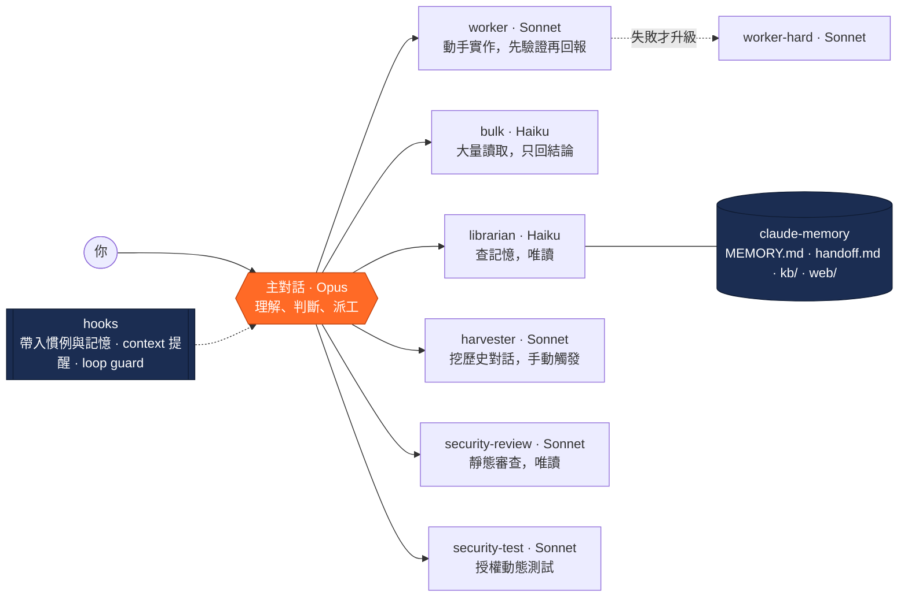

<p align="center">
  
</p>

<p align="center">
  <a href="https://github.com/Novie131/chutora/actions/workflows/ci.yml"></a>
  
  
  
  <a href="LICENSE"></a>
</p>

<p align="center"><b>繁體中文</b> · <a href="README.en.md"><b>English</b></a></p>

<p align="center">
  <a href="#quick-start"> 快速開始</a> ·
  <a href="#features"> 功能總覽</a> ·
  <a href="#how-it-works"> 運作方式</a> ·
  <a href="#docs"> 更多文件</a> ·
  <a href="#roadmap"> 路線圖</a>
</p>

# Chutora

<sub>唸作 <b>choo-TOR-a</b>（啾托拉）· 取自 chute（降落傘）</sub>

**讓 Claude Code 像一個小團隊一樣分工：Opus 當主管負責想，Sonnet 和 Haiku 負責動手；對話變長時先寫交接筆記，卡住時有固定的脫困路線。**

> **Agent = 模型 + Harness。** Chutora 不換模型，改的是模型外圍那一圈：誰來做、記得什麼、卡住時怎麼脫身。

> A Claude Code plugin for tiered model delegation — Opus plans, Sonnet executes, Haiku retrieves and digests bulk output — plus handoff notes, source-cited memory, loop guards and a self-tuning harness. English documentation: [README.en.md](README.en.md).

<a name="why"></a>

##  為什麼是 Chutora

**目的**：用同樣的預算做更多事，長時間工作也不會越拉越貴、越來越亂；真的卡住時，有一條拉得到的繩子。

| 常見困境 | 單用 Claude Code | 加上 Chutora |
|---|---|---|
|  所有事都用最貴的模型 | 讀 log、看截圖、改幾十個檔都付 Opus 的價 | Opus 只負責想和判斷，動手交給 Sonnet，大量讀取交給 Haiku |
|  對話越拉越長 | 越後面越貴、越亂；一清空進度就沒了 | 超過 10 萬 token 先提醒寫交接筆記；壓縮、`/clear` 或隔天開新對話都自動接回 |
|  AI 卡在同一個錯誤 | 反覆重試、一直燒 token | loop guard 提醒換方向；失敗依固定順序升級，不會無限重試 |
|  「之前好像講過」 | 每次都要重新解釋 | 記憶就是 Markdown，librarian 查回原文與出處，可以進 git、用 Obsidian 開 |
|  結論可不可信 | 事實和推測混在一起 | evidence-analysis 把結論分成觀察、推論、未知，附出處 |
|  安全 | 要自己想到才會審 | security-review 靜態審查，security-test 只在授權的隔離環境動態測試 |
|  越用越順手 | 同樣的話每次都要多講一遍 | harness-tune 把教訓固化進 harness，記在 harness-lessons |
|  錢花在哪 | 看不到 | usage-stats 量測報表，agent-board 即時看板 |

**裝完就能用**：兩行指令，不用改你的 CLAUDE.md。進階設定一次只問一項，改設定前先備份；子 agent 回報完成前必須驗證，遇到岔路會停下來問你。

<a name="demo"></a>

###  40 秒看懂 Chutora

<p align="center"><a href="assets/demo.mp4"></a></p>
<p align="center"><sub>示意動畫，不是實機錄影 · <a href="assets/demo.mp4">▶ 觀看完整 41 秒影片（中英字幕）</a></sub></p>

---

<a name="quick-start"></a>

##  三分鐘上手

**1. 安裝**：在 Claude Code 裡輸入

```
/plugin install chutora --marketplace Novie131/chutora
/reload-plugins
/model opus
```

（Claude Code 2.1.275 以前：先 `/plugin marketplace add Novie131/chutora`，再 `/plugin install chutora@chutora`。不想用 marketplace，見[其他安裝方式](docs/advanced.md#install)。主對話建議用 Opus，plugin 不會自動幫你改。）

**2. 輸入 `/chutora`**

這是唯一要記的指令。它會顯示目前狀態：版本、模式、context 用量、有沒有卡在同一個錯誤，再列出能做的事，回覆編號就好。交接、用量報表、健檢、切換模式和語言、完整設定都在裡面。

裝完覺得沒反應，先跑 `/chutora doctor`，它會逐項檢查並告訴你怎麼修。

**3. 照平常講話**

主對話會自己判斷要不要派工：說「照剛才講的做」就交給 worker，「看這份 log 為什麼失敗」就交給 bulk，「我之前記過 X 嗎」就交給 librarian。對話超過 10 萬 token 會提醒你先寫交接筆記，之後不管是 `/clear` 還是隔天開新對話，進度都會自動接回。

**4. 卡住怎麼辦**

- 同一個錯誤一直重複時，loop guard 會提醒 Claude 換方向；你也可以直接說「換個做法」或「先停下來整理目前試過什麼」。
- 想退回之前的狀態：Claude Code 內建的 `/rewind`（或按兩下 Esc）能還原主對話直接改的檔案；子 agent 和 Bash 指令改的檔案不在它的範圍內，這部分請用 git 還原。
- 想換個乾淨的對話重來：說「交接一下」寫好 `handoff.md`，再 `/clear`。
- 一鍵的「卡關救援」正在做，見[路線圖](#roadmap)。

**想要完整功能**：執行 `/chutora:route-setup`，它會一項一項帶你設定狀態列、自動壓縮門檻、Haiku 版 Explore、`claude-memory/` 記憶庫，每項都說明影響和怎麼還原，改設定前會備份。提醒類功能需要 `python3`，沒有的話會安靜停用。

---

<a name="features"></a>

##  功能總覽

依用途分成八類。「觸發」欄的 **自動** 表示裝好就會運作，不用下指令；**派工** 表示照平常講話，主對話會自己判斷要不要交給它；**指令** 表示你要叫它（plugin 安裝時寫成 `/chutora:<名稱>`，install.sh 安裝時直接 `/<名稱>`）；**選裝** 表示要另外安裝或設定。

### 1. 分層派工：貴的模型只用在刀口上

| 功能 | 觸發 | 做什麼 |
|---|---|---|
| `worker`（Sonnet） | 派工 | 方向已定的實作：寫或改程式、修 bug、補測試。回報完成前必須先驗證 |
| `worker-hard`（Sonnet，effort high） | 派工 | 只在 worker 失敗後使用，必須附上前次失敗報告 |
| `bulk`（Haiku） | 派工 | 大量讀取只回結論：多張圖片或影格、長 log、抓網頁、輸出很多的指令、規則明確的批次修改 |
| Haiku 版 `Explore` | 選裝 | 搜尋程式碼、找檔案。內建 Explore 會跟著主對話跑 Opus，換成這個改跑 Haiku |
| 驗證回報與失敗升級 | 自動 | 子 agent 用固定格式回報狀態與驗證結果；失敗依序升級，不會無限重試；遇到岔路會停下來問你 |

### 2. 長對話管理：對話變長也不失控

| 功能 | 觸發 | 做什麼 |
|---|---|---|
| context 長度提醒 | 自動 | 超過 10 萬 token 提醒一次，之後每多 4 萬再提醒（可用 `CONTEXT_REMIND_TOKENS` 調整） |
| `handoff` | 指令 | 把目前任務、已完成、下一步、未決問題寫進 `handoff.md`，之後可以放心 `/clear`。說「交接一下」也會觸發 |
| 交接筆記自動帶回 | 自動 | 新對話、`/clear`、自動壓縮之後，自動帶入分工慣例、記憶索引與 `handoff.md` |
| context 狀態列 | 選裝 | 顯示 `模型 │ ctx 95k │ 提醒 100k │ 壓縮 120k` |
| 自動壓縮門檻 | 選裝 | 在 `settings.json` 設 `autoCompactWindow` 當保險，`route-setup` 可以幫你安全寫入 |

### 3. 記憶與知識庫：跨對話累積

| 功能 | 觸發 | 做什麼 |
|---|---|---|
| `claude-memory/` 記憶庫 | 選裝 | 一般 Markdown 檔：`MEMORY.md` 索引、`topics/` agent 累積的知識、`kb/` 你的筆記、`web/` 外部資料。可以進 git、用 Obsidian 開 |
| `librarian`（Haiku） | 派工 | 問「之前記過什麼」時查記憶與知識庫。只讀不寫，回傳原文片段與出處 |
| `research` | 派工／指令 | 查官方文件、API 用法、版本差異等可能已變動的資訊，回答附來源，官方資料存進 `web/` |
| `harvester`（Sonnet） | 只在你明確要求時 | 把過去的對話紀錄挖成知識庫筆記。成本較高，偶爾跑一次 |
| micro-skills | 內建範本 | `MEMORY.md` 範本與分工慣例裡的寫法：把專案的固定指令與事實寫成短小的條件式記憶，用到才讀，少走回頭路 |

### 4. 分析品質：分清事實與推測

| 功能 | 觸發 | 做什麼 |
|---|---|---|
| `evidence-analysis` | 派工／指令 | 調查、找根因、審查結論時使用。每個結論標成觀察、推論或未知並附出處，先給概覽再深入，最後留一份可追查的 finding ledger |

### 5. 資安：只用於你自己或已授權的程式碼

| 功能 | 觸發 | 做什麼 |
|---|---|---|
| `security-review`（Sonnet） | 派工 | 靜態審查：對照 OWASP 類別，找不安全寫法、金鑰或 token 外洩。只讀不改，回報附證據、嚴重度與修補建議 |
| `security-test`（Sonnet） | 派工 | 動態測試：實際打你已授權且隔離的 dev／測試環境，驗證漏洞。開工前一定先確認授權範圍，不碰 production、不外送資料 |

### 6. 省 token 與量測：知道錢花在哪

| 功能 | 觸發 | 做什麼 |
|---|---|---|
| loop guard | 自動 | 同一個錯誤一再重複時提醒換方向，只提醒不中斷；同時記錄各工具的使用次數 |
| `toolprune` | 指令 | 讀工具使用記錄，列出長期沒用到、可以關掉的工具或 MCP。只建議不自動改，一步就能復原 |
| 每週回顧 | 自動 | 每週第一個對話附一行估算：子 agent 的工作若改由主對話模型處理，依 API 牌價要多花多少；`CHUTORA_WEEKLY=0` 關閉 |
| `usage-stats` | 指令 | 量主對話 context 長度、各 agent 的派工次數、token 用量與估計金額；加 `--html` 輸出有每日圖表的報表 |

### 7. 自我強化：越用越順手

| 功能 | 觸發 | 做什麼 |
|---|---|---|
| `harness-tune` | 指令 | 某類任務一再做不順時使用：先讀過去的教訓，提出一到三個小調整，你確認後一次只改一項，改前備份、可回滾 |
| `harness-lessons.md` | 自動（由 harness-tune 寫入） | 記錄每次調整的結果（有效、無效、已還原），下一次調整從上一次的結論出發 |

### 8. 入口、介面與設定

| 功能 | 觸發 | 做什麼 |
|---|---|---|
| `/chutora` | 指令 | 單一入口：狀態總覽（版本、模式、context、loop guard）加上功能選單，回覆編號就能執行 |
| `/chutora doctor` | 指令 | 唯讀安裝健檢：python3、hooks、狀態列、記憶庫、自動壓縮、Haiku Explore、舊版殘留，要修的項目附修法 |
| 三種模式 | 指令 | `/chutora mode economy`／`balanced`／`quality`：改變 session 開始時帶入的派工慣例（派工積極度、升級時機、驗證範圍），不改各 agent 的模型 |
| 中英雙語 | 自動 | 提醒訊息、狀態列、`/chutora` 依系統語言切換；`/chutora lang zh`／`en`／`auto` 可固定 |
| `agent-board` | 選裝 | 輸入框上方的常駐看板，即時列出每個子 agent 的類型、模型、狀態、經過時間、token 與估計金額。用 `/agent-board` 開關 |
| `reply-detail` | 選裝 | 回覆預設精簡三段（現況／你要做的／需要你決定或提供）；用看板的「⇄ 回覆：精簡／詳細」切換，或輸入「詳細說明」單次改寫成詳細版 |
| `route-setup` | 指令 | 一次性完整設定：記憶庫、Haiku 版 Explore、自動壓縮門檻、狀態列。一次只問一項，改設定前先備份 |

---

<a name="how-it-works"></a>

##  運作方式



| 元件 | 模型 | 做什麼 |
|---|---|---|
| worker | Sonnet，effort medium | 方向已定的實作：寫程式、修 bug、補測試。回報完成前必須先驗證 |
| worker-hard | Sonnet，effort high | 只在 worker 失敗後使用，派工時必須附上前次失敗報告 |
| bulk | Haiku | 大量讀取、只回結論：大量圖片、長 log、網頁、輸出很多的指令，以及機械式的批次修改 |
| librarian | Haiku，effort low | 查知識庫與記憶。只有 `Read`、`Glob`、`Grep`，什麼都改不了；回傳原文片段與來源，並說明搜過哪些詞、什麼沒找到 |
| harvester | Sonnet | 把歷史對話逐字稿挖進知識庫筆記。只在你明確要求時才跑，成本不低 |
| security-review | Sonnet，effort medium | 對你自己的程式碼做靜態安全審查（OWASP 類別、附證據與修補、嚴重度分級）。只讀不改，只用於你擁有或授權的碼 |
| security-test | Sonnet，effort medium | 對你自己、已授權且隔離的 dev 環境做動態安全測試，驗證漏洞是否可利用。開工先確認授權範圍，不碰 production、不外送資料 |
| Explore（選裝） | Haiku | 內建 Explore 在主對話是 Opus 時也跑 Opus。plugin 蓋不掉它（只有使用者或專案層級、名為 `Explore` 的 agent 能覆蓋），所以用 route-setup 或 `bash install.sh --with-explore` 把 Haiku 版裝進 `~/.claude/agents/` |

- **Skills**：`handoff` 寫 `handoff.md`；`research` 查外部資料並附來源；`usage-stats` 量測主對話 context 長度、各 agent 的派工次數、token 用量與估計金額（唯讀；加 `--html` 可輸出圖表報表）；`route-setup` 是一次性完整設定。
- **Hooks**：SessionStart 帶入分工慣例、記憶索引與交接筆記；UserPromptSubmit 在 context 過長時提醒。
- **新增能力**：`evidence-analysis`（證據導向分析：結論分 觀察／推論／未知 並附出處）；`security-review`／`security-test`（防禦性安全：靜態審查＋授權動態測試）。安全能力只用於你自己或明確授權的程式碼與環境，動態測試只在隔離環境、不碰 production、不外送資料。
- **省 token 與自我強化**：`toolprune`（指認長期沒用到的工具、建議停用，可逆）；`harness-tune`（針對某類任務調整 harness，改前確認、可回滾，取自 harness2）；PostToolUse `loop guard` hook（同一錯誤重複就提醒換方向，只提醒不中斷，取自 TokenEconomizer）；micro-skills（把這個 repo 的固定指令事實記進記憶，少走回頭路）。

主對話怎麼分工，不靠你的 CLAUDE.md：SessionStart hook 會在每個 session 開始時把分工表帶進去（內容見 `hooks/guide.md`）。設計理由與取捨見 [docs/spec.md](docs/spec.md)。

---

<a name="docs"></a>

##  更多文件

| 文件 | 內容 |
|---|---|
| [進階說明](docs/advanced.md) | 這解決什麼問題、使用方式與名詞小抄、三種模式／語言／每週回顧、運作細節、進階設定、記憶、設計取捨、其他安裝方式、目錄結構 |
| [常見問題](docs/faq.md) | 要不要付費、會不會改我的設定、跟 `/rewind` 差在哪、省錢模式會不會變差 |
| [疑難排解](docs/troubleshooting.md) | 裝了沒反應、提醒變成英文、狀態列沒出現、agent 出現兩份 |
| [部署安裝](docs/部署安裝.md) | install.sh、移除、從舊版升級 |
| [架構設計](docs/spec.md) | 設計理由與實作附錄 |

---

<a name="roadmap"></a>

##  路線圖

| 狀態 | 項目 | 說明 |
|---|---|---|
|  已完成（0.12） | 好用優化 | `/chutora` 單一入口、`/chutora doctor` 安裝健檢、中英雙語提醒、三種模式、每週回顧、文件分成三分鐘上手與進階說明 |
|  下一步 | **卡關救援 `/chutora:rescue`**（招牌功能） | AI 反覆失敗、越修越亂時一鍵救援：收集證據、停損、給你兩三條脫困路線選、把教訓記下來，下次不再卡在同一處 |
|  規劃中 | 程式碼地圖與影響範圍 | 產生精簡的符號索引存進記憶，改函式前先列出會受影響的地方；檔案改了會提醒索引過期 |
|  規劃中 | 危險操作守門 | 刪檔、force push、動 production 這類操作一律先確認 |
|  規劃中 | 路由從結果學習 | 記下每次派工的結果，整理成委派表的修正建議，你確認才改 |
|  規劃中 | 專案健檢 | 在 `/chutora doctor` 的安裝健檢之外，再一次檢查測試缺口、過期記憶、沒用到的工具、安全快掃 |

所有新功能都照同一個原則：**輕量、手動、可逆**，不為了自動化多燒 token。

**吸收過的開源方法論**：rea（證據導向分析）、strix（安全審查與測試）、TokenEconomizer（省 token）、[harness2](https://github.com/google-research/harness2)（自我強化）；規劃中的項目參考 [ruflo](https://github.com/ruvnet/ruflo) 與 [codegraph](https://github.com/colbymchenry/codegraph)。Chutora 只取方法論、自己實作，不含它們的程式碼。

---

<a name="status"></a>

##  狀態

**v0.12.0 — 早期版本。** 0.10.0 以前叫 smart-agent-route、0.7.0 以前叫 tiered-agents，升級請先移除舊版（見 [docs/部署安裝.md](docs/部署安裝.md#從-smart-agent-route0100-以前升級)）。 context 提醒 hook、handoff、bulk、Explore 覆蓋版移植自作者的個人設定：hook 已在真實對話中觸發、Explore 與 bulk 已確認跑在 Haiku，但都還在驗證期。worker-hard 升級鏈、research skill 與 plugin 形式的 hook 尚未實際使用。agent-board 與 reply-detail 已在 VS Code 擴充 2.1.301 實測過看板；常駐模式、看板裡的按鈕與回覆格式注入還在驗證。0.12 新增的 `/chutora`、doctor、三種模式、中英雙語與每週回顧已有單元測試，還沒在真實對話中長期驗證。

已知會需要調整的地方：

- 委派靠 `description` 匹配，不是保證。要確定就 `@agent-chutora:worker`
- hook 在 Cowork 的行為未驗證
- `MEMORY.md` 會腐化，需要你定期整理（超過 150 行即是訊號）
- Haiku 執行層預設留空，見 `plugins/chutora/skills/route-setup/templates/runner.md.example` 的啟用條件
- `harvester` 只讀得到本機 session
- mod 的 API 標示為搶先體驗（early access），Claude Code 改版時可能要跟著調整

歡迎開 issue。

---

<a name="license"></a>

##  授權

MIT
